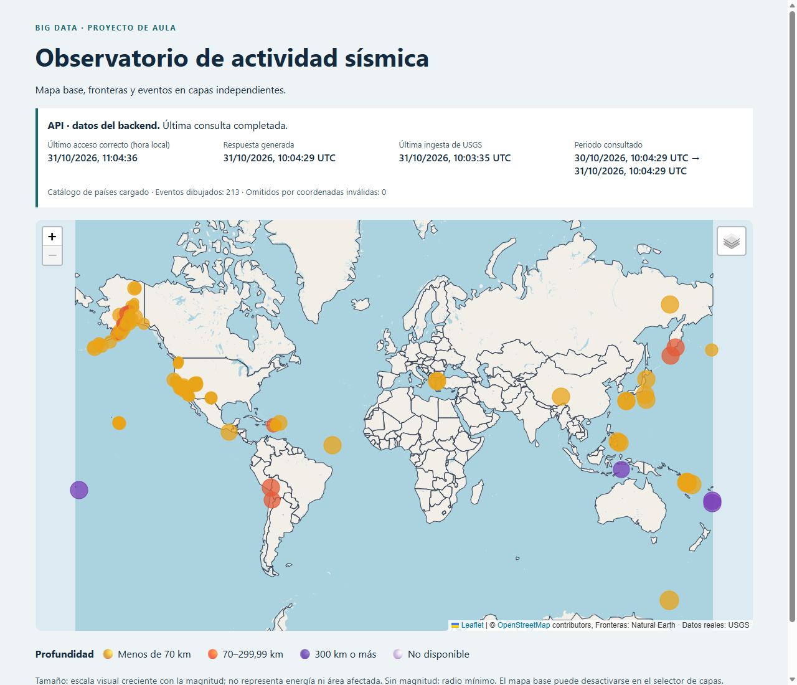
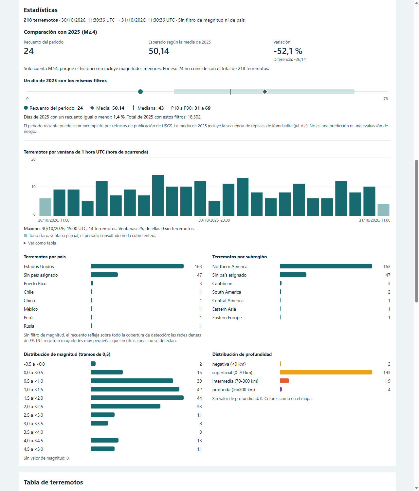
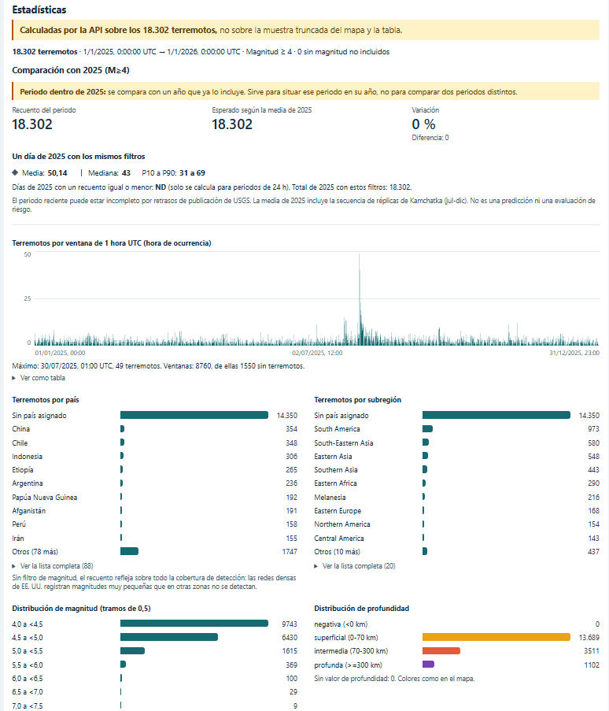
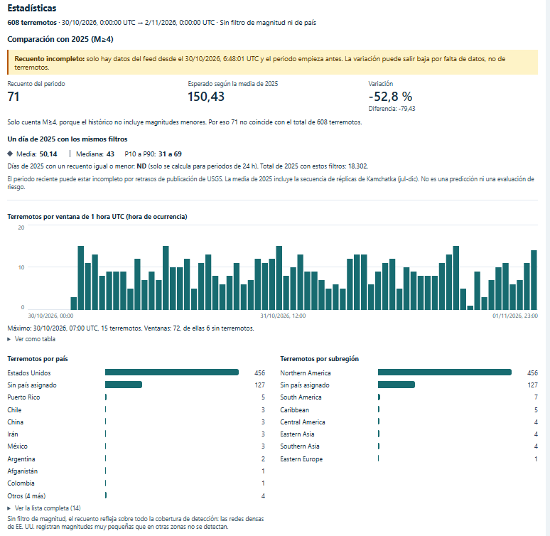
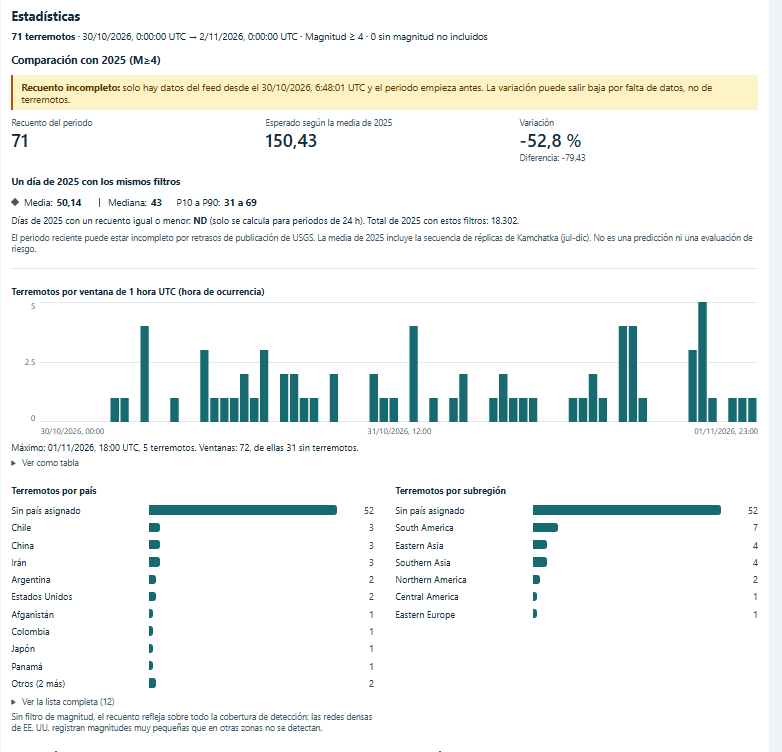
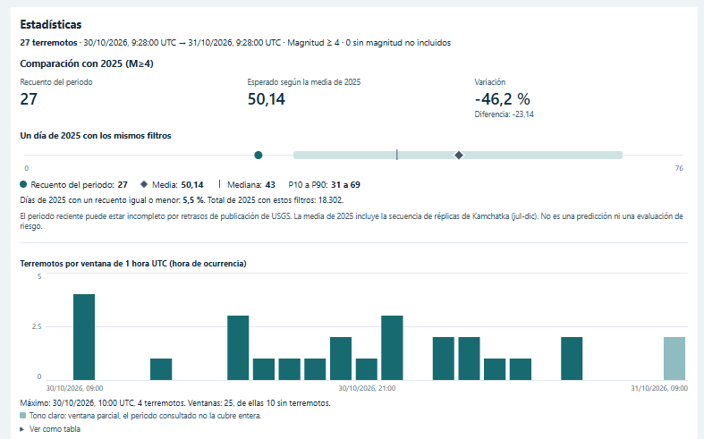
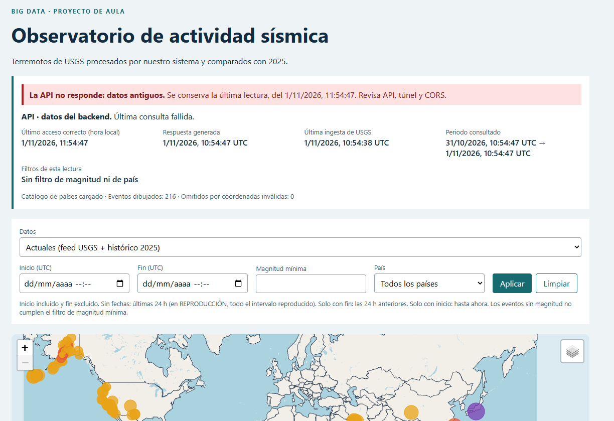
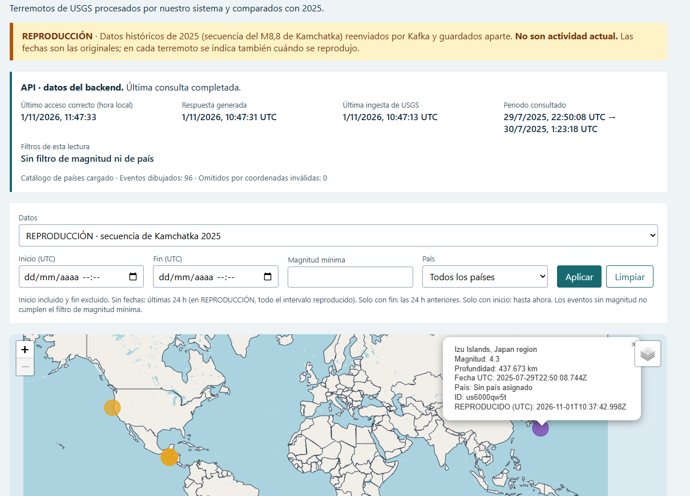

# Observatorio de actividad sísmica

Proyecto de Sistemas de Big Data · Curso de especialización en IA y Big Data · CPIFP Alan Turing (Málaga).
Autor: **Daniel Meléndez Loreto**. Trabajo individual.

**Pregunta:** ¿dónde se está registrando actividad sísmica y cómo se compara con un periodo histórico equivalente (2025)?

```text
USGS feed (cada 60 s) → productor (Python) → Kafka → consumidor (Python) → PostgreSQL → API (FastAPI) → ngrok (HTTPS) → panel (Angular + Leaflet, Netlify)
```

| Enlace | Dirección |
|---|---|
| Panel publicado | https://adorable-zabaione-a69bde.netlify.app/ |
| API pública (túnel) | https://unbolted-decorated-heaving.ngrok-free.dev/api/salud — **solo responde con el equipo del autor encendido** |
| Memoria | [`docs/memoria.md`](docs/memoria.md) |
| Evidencias | [`docs/evidencias/`](docs/evidencias/) (mapa al final de este README) |

**Contenido de este README:** [cómo se cumple la rúbrica](#cómo-se-cumple-la-rúbrica-enunciado-13) ·
[las tres conclusiones](#resultados-las-tres-conclusiones) · [pruebas de aceptación](#pruebas-de-aceptación-enunciado-11) ·
[ciclo de desarrollo con IA](#ciclo-de-desarrollo-cómo-se-ha-construido) · [activar el sistema](#activar-el-sistema-para-la-demostración-guía-de-entregables-32) ·
instalación y uso (§1–§9) · [estructura](#10-estructura-del-repositorio) · [evidencias](#11-dónde-está-cada-evidencia).

### Vista del panel

| Datos reales del feed, con filtros, estado del sistema y mapa | Estadísticas: ventanas de 1 h UTC, país, magnitud y profundidad |
|---|---|
|  |  |

---

## Cómo se cumple la rúbrica (enunciado §13)

Resumen; debajo, cada criterio con su explicación y **los resultados reales**. Los enlaces solo llevan al detalle completo.

| Criterio | En una frase |
|---|---|
| [Extracción](#extracción) | Feed cada 60 s publicando solo novedades, histórico 2025 completo (18.302 eventos) y catálogo de países integrado por punto en polígono |
| [Calidad](#calidad) | 15 reglas con motivo, cuarentena con el original, 6 dimensiones medidas con SQL y tabla antes → después |
| [Modelado](#modelado) | Hecho + dimensiones + historial, idempotencia por claves y UPSERT condicionado, índices medidos |
| [Análisis](#análisis) | Ventanas de 1 h UTC, distribuciones, comparación equivalente con 2025 (media, mediana, percentiles) y 3 conclusiones |
| [Reflexión](#reflexión) | 3 operaciones medidas con 3 tamaños, 100 millones de registros, costes y propuesta de escalado |

### Extracción

**Feed en tiempo real.** El productor ([`productor.py`](backend/src/productor.py)) descarga `all_day.geojson` cada 60 s.
Cada respuesta trae las 24 h completas, así que compara `id` + `updated` con lo ya publicado y solo publica lo nuevo o
revisado. Primero espera la confirmación de Kafka y después lo marca como publicado (si se cae en medio, se reenvía; nunca se pierde):

```python
conocido = publicadas.get(event_id)               # última versión publicada de ese id (diccionario, O(1))
if conocido is not None and updated <= conocido:
    continue                                      # misma versión o más antigua -> no se publica
await productor.send_and_wait(TOPIC, value=..., key=event_id.encode("utf-8"))   # 1) publicar y ESPERAR a Kafka
await db.marcar_publicada(conn, event_id, updated)                               # 2) solo después, marcarla
```

Log real (03/11/2026): cada línea es una consulta; `eventos` = lo que trae la ventana de 24 h, `publicados` = novedades.

```text
[productor] OK eventos=216 publicados=0 sin_identidad=0 original=sin cambios 599 ms
[productor] OK eventos=215 publicados=1 sin_identidad=0 original=feed-all_day-20261103T190054Z.geojson.gz 596 ms
[productor] OK eventos=213 publicados=2 sin_identidad=0 original=feed-all_day-20261103T190258Z.geojson.gz 617 ms
```

Errores de red, HTTP 429/5xx o JSON roto se reintentan con esperas de 2, 4 y 8 s (D20); cada intento queda en la tabla
`consulta_ingesta`. El GeoJSON original se guarda comprimido en `data/raw/` solo si cambian los terremotos, con 24 h de
retención. Tras una parada de menos de 24 h, la primera consulta recupera lo perdido (comprobado, por ejemplo: 175, 212 y 194 eventos recuperados en tres arranques tras parar el sistema por la noche).

**Histórico 2025** ([`historico_descargar.py`](backend/src/historico_descargar.py)): mundial, M ≥ 4, `eventtype=earthquake`,
12 consultas mensuales a la API FDSN el 31/10/2026. Antes de cada descarga se pide el `count`; si un mes pasara de
20.000 se dividiría solo. Los extremos de la API son inclusivos, así que se deduplica entre meses.

| Resultado | Valor |
|---|---|
| Eventos descargados | **18.302** (`count` = descargados en los 12 meses: sin truncar) |
| Mes con más eventos | julio, 2.684 (lejos del límite de 20.000) |
| Repetidos entre meses | 0 |
| Registro | `data/historico/manifest.json` + tabla `consulta_ingesta`; tabla completa en [memoria §3](docs/memoria.md) |

**Exploración de la fuente** ([notebook](analisis/01_exploracion_feed.ipynb), muestra de 187 eventos):

| Campo / comprobación | Resultado |
|---|---|
| Estructura | `FeatureCollection`; cada evento con `id`, `geometry` (`Point` [lon, lat, profundidad km]) y 26 propiedades |
| Tiempos | `time` y `updated` en milisegundos Unix → se convierten a UTC |
| Tipos de evento | 185 `earthquake`, 2 `explosion` (en vivo apareció además `quarry blast`) |
| Magnitud | 0,22 a 6,0; escalas `ml`, `md`, `mb`, `mww` (no son comparables entre sí) |
| Profundidad | −2,31 a 509,07 km (negativas posibles según USGS) |
| `updated − time` | mediana 3,6 min, máximo 925,8 min: los eventos se revisan |
| Campos opcionales | `tz` 0 %, `alert` 3,2 %, `mmi` 4,8 %, `cdi`/`felt` 8,6 % |

**Catálogo de países** ([`geografia.py`](backend/src/geografia.py)): Natural Earth (copia del profesor, 177 entidades,
WGS84). `ADM0_A3` es único (177/177) y se usa como clave sin suponer que sea ISO. El país se asigna por punto en
polígono (Shapely + índice STRtree, `covered_by`: un punto en la frontera cuenta como dentro; si cayera en dos, gana el
código menor). No se usa el texto de `place` ni se asigna el país más cercano: si no cae en ninguno, «Sin país asignado».
Las geometrías de USA y SDN no eran válidas y se reparan en memoria con `make_valid`. Verificado: STRtree y un bucle
sobre los 177 polígonos dan el mismo país en 8.000/8.000 puntos.

### Calidad

**Reglas del consumidor** ([`validacion.py`](backend/src/validacion.py)): cada mensaje se valida antes de guardarse.
Lo que no pasa va a la tabla `cuarentena` con su motivo y el mensaje original (y su topic, partición y offset de Kafka).

| Regla | Si falla | Motivo guardado |
|---|---|---|
| Contrato del mensaje (`schema_version = 1`, `event`) | inválido | `schema_version_desconocida`, `sin_evento` |
| `id` presente; `updated` y `time` enteros | inválido | `sin_id`, `updated_invalido`, `time_invalido` |
| `type == "earthquake"` | **excluido** (dato correcto, fuera de alcance) | `type=explosion`, `type=quarry blast`… |
| Geometría `Point` con lon/lat numéricas y en rango | inválido | `geometria_no_point`, `lat_fuera_de_rango`, `lon_fuera_de_rango`… |
| Profundidad y magnitud numéricas **si existen** | inválido | `profundidad_no_numerica`, `mag_no_numerica` |
| Fecha dentro de la dimensión fecha (2024–2027) | inválido | `fecha_fuera_de_dimension` |

No se rechaza lo que parece raro pero es válido: **magnitud nula** (se guarda NULL y se muestra «ND»; no se rellena con
0 porque M0 existe), **magnitudes negativas** (7 en la base) y **profundidades negativas** (9; USGS las mide respecto al geoide).

Cuarentena real (consulta del 04/11/2026; los `PRUEBA-…` son casos sintéticos marcados a propósito):

```text
docker compose exec postgres psql -U observatorio -d observatorio -c "SELECT tipo, motivo, COUNT(*) FROM cuarentena GROUP BY 1, 2;"
   tipo   |       motivo       | count
----------+--------------------+-------
 excluido | type=explosion     |    12      <- 11 reales + PRUEBA-EXPLOSION
 excluido | type=quarry blast  |    12
 invalido | lat_fuera_de_rango |     1      <- PRUEBA-LAT145 (sintético): 0 datos rotos reales
```

**Las 6 dimensiones** ([`calidad.sql`](analisis/calidad.sql), 01/11/2026; denominador: terremotos reales, 18.302 del histórico + 549 del feed):

| Dimensión | Resultado | Acción |
|---|---|---|
| Completitud | `mag`, `mag_type`, `depth_km`, `place`, `status`: 100 %. País: 21,6 % (histórico) y 79,1 % (feed) | Nulos conservados; sin país ≠ error (la mayoría de M ≥ 4 ocurre en el mar) |
| Unicidad | 18.854 filas = 18.854 ids; 0 versiones repetidas; un terremoto de Alaska con 33 versiones | Claves primarias + UPSERT |
| Validez | 0 coordenadas fuera de rango; mag −0,93 a 8,8; profundidad −3,04 a 669,6 km | Negativas conservadas y señaladas |
| Consistencia | 0 países inexistentes, 0 días mal calculados, 0 actualizados antes de ocurrir; el estado actual tiene siempre la última versión | Claves foráneas y una sola transformación de fechas |
| Actualidad | Ocurrencia → actualización de USGS: mediana 11,3 min. Actualización → nuestra descarga: mediana 61 s (p90 96 s). 1.096 consultas correctas, 1 fallida (recuperada) | Coherente con consultar cada 60 s |
| Exactitud | **No verificable**: que un valor sea numérico y esté en rango no demuestra que sea exacto. Sí se contrastó: `count` FDSN = descargados; STRtree = fuerza bruta; feed frente a catálogo en un día (27 de 28, 0 cambios de magnitud) | Limitación declarada |

**Antes → acción → después** (terremotos reales):

| Problema | Antes | Acción | Después |
|---|---|---|---|
| Misma versión recibida varias veces | Cada 60 s llega otra vez toda la ventana de 24 h | El productor solo publica novedades; el consumidor ignora `(id, updated)` ya guardados | 0 versiones repetidas |
| Revisiones de un terremoto | 85 terremotos con 2 a 33 versiones | Todas al historial; el estado actual, solo la última | 1 fila por terremoto |
| Eventos que no son terremotos | explosiones y voladuras | Excluir con motivo | Fuera del análisis, en cuarentena |
| Magnitud / profundidad negativas | 7 / 9 | Conservar y señalar | Visibles en el análisis |
| Sin país | 14.465 (76,7 %) | No inventar país | «Sin país asignado» en todos los recuentos |
| Geometrías no válidas del catálogo | USA y SDN | `make_valid` | 483 terremotos asignados a esos países |

Detalle completo: [memoria §5](docs/memoria.md) · salida de las consultas: `docs/evidencias/fase13-calidad.txt`.

### Modelado

**Modelo** ([`01_esquema.sql`](sql/01_esquema.sql)): un terremoto ocurre en un día UTC, puede estar en un país (0 o 1) y
tiene una o varias versiones. El grano de cada tabla:

| Tabla | Tipo | Una fila = | Clave |
|---|---|---|---|
| `evento_actual` | Hecho | un terremoto, en su versión más reciente | PK `event_id`; FK a `fecha` y a `pais` (admite NULL = sin país) |
| `evento_version` | Historial | una versión recibida, con el original JSON | PK `(event_id, updated_ms)` |
| `pais` | Dimensión | una entidad de Natural Earth | PK `country_id` (`ADM0_A3`) |
| `fecha` | Dimensión | un día UTC (2024–2027) | PK `fecha_id` |
| `cuarentena` | Calidad | un mensaje rechazado | UNIQUE `(topic, partición, offset)` |
| `version_publicada` · `consulta_ingesta` | Estado y procedencia | la última versión publicada · una petición a USGS | PK |

Los terremotos se cuentan en `evento_actual`: en el historial, uno revisado 33 veces contaría 33.

**Idempotencia.** Kafka no elimina duplicados (comprobado: el mismo mensaje enviado dos veces queda en los offsets 0 y 1).
Lo resuelve la base de datos, en [`db.py`](backend/src/db.py):

```sql
INSERT INTO evento_actual (event_id, updated_ms, mag, ...) VALUES (...)
ON CONFLICT (event_id) DO UPDATE SET updated_ms = EXCLUDED.updated_ms, mag = EXCLUDED.mag, ...
WHERE evento_actual.updated_ms < EXCLUDED.updated_ms      -- solo si la versión que llega es MÁS NUEVA
```

El historial usa `ON CONFLICT (event_id, updated_ms) DO NOTHING`. Las dos escrituras van en **una transacción**, y el
consumidor confirma el offset de Kafka **después** de guardar («al menos una vez»): si se cae en medio, reprocesa el
mensaje y la base no cambia.

Resultado de la secuencia de la FAQ 12 (8 mensajes con duplicado, revisión 4,2 → 4,6 y versión antigua tardía):

```text
evento_actual (3 filas)                 evento_version (4 filas)
 PRUEBA-E1      | 4.6  <- no vuelve a 4,2    PRUEBA-E1      | 10:05 | 4.2
 PRUEBA-E2      | 3.1                        PRUEBA-E1      | 10:09 | 4.6
 PRUEBA-MAGNULA | NULL                       PRUEBA-E2      | 10:12 | 3.1
                                             PRUEBA-MAGNULA | 10:20 | NULL
```

**Índices** justificados por las consultas de la API: `event_time` (filtros por intervalo y ventanas horarias) y
`country_id` (filtro y recuento por país); las claves primarias crean el suyo. Medido con 3 millones de filas
sintéticas: búsqueda por id ≈2.000 veces más rápida con índice ([Reflexión](#reflexión)).

Detalle: [memoria §3bis y §6](docs/memoria.md) · `docs/evidencias/fase5-faq12-idempotencia.txt`.

### Análisis

Todo se calcula en la API ([`api.py`](backend/src/api.py)) sobre `evento_actual`, con los **mismos filtros** que el mapa
(fecha UTC, magnitud mínima y país), así que las revisiones se reflejan sin contadores:

- **Ventanas fijas de 1 h UTC por hora de ocurrencia** (`[hh:00, hh+1:00)`), incluidas las horas sin terremotos.
- **Recuentos por país y subregión**, con «Sin país asignado» como categoría propia.
- **Distribuciones** de magnitud (tramos de 0,5) y profundidad (superficial, intermedia, profunda), indicando cuántos no tienen valor.
- **Comparación con 2025** con los mismos filtros (M ≥ 4, mundial, `earthquake`). La media diaria divide entre 365,
  días con cero incluidos: 18.302 / 365 = **50,14**. Como la media sola engaña, se añade la mediana, el rango P10–P90 y el %
  de días de 2025 con un recuento igual o menor. Ejemplo real (30/10/2026 09:28 → 31/10/2026 09:28 UTC):

| Recuento | Media 2025 | Variación | Mediana 2025 | P10–P90 | Días de 2025 con ≤ 27 |
|---|---|---|---|---|---|
| 27 | 50,14 | −46,2 % | 43 | 31–69 | 5,5 % |

El panel avisa cuando el porcentaje no significa lo que parece (D39): periodo que empieza antes de los datos del feed,
que termina en el futuro, que cae dentro de 2025, o con menos de 1 terremoto esperado. Las tres conclusiones, con sus
capturas, están [más abajo](#resultados-las-tres-conclusiones). Detalle: [memoria §7 y §7bis](docs/memoria.md).

### Reflexión

Mediciones en el equipo del autor (Ryzen 7 5800X, 32 GB, Docker sobre WSL2), mediana de 5 repeticiones, 3 tamaños
([`medir.py`](backend/src/medir.py); resultados en `data/mediciones/`). Los datos sintéticos (`SINT-…`) van en un esquema
aparte que se borra al terminar.

| Operación | Tamaños | Sin estructura | Con estructura | Complejidad |
|---|---|---|---|---|
| Buscar la versión publicada de un id (productor) | 1.000 / 10.000 / 100.000 ids | Lista: 8,5 / 79 / 790 µs | Diccionario: 0,028 / 0,032 / 0,034 µs (**≈23.000×**) | O(N) frente a O(1) de media |
| Asignar país (consumidor) | 500 / 2.000 / 8.000 puntos | 177 polígonos uno a uno: 319 / 1.152 / 4.586 ms | STRtree: 65 / 141 / 577 ms (**≈8×**, mismo resultado) | O(P) frente a O(log P + c) |
| Ventanas de 1 h (API) | 1 día / 31 días / 365 días | — | 0,16 / 1,51 / 12,57 ms | O(log N + k + W) |
| Buscar por id en PostgreSQL | 0,1 / 1 / 3 millones de filas | Sin índice: 3,8 / 21,8 / 60,9 ms | Con índice: 0,039 / 0,031 / 0,030 ms (**≈2.000×**) | O(N) frente a O(log N) |

El índice no es gratis: con 3 millones de filas, los dos índices ocupan 162 MB frente a 181 MB de la tabla.

**Con 100 millones de registros** (extrapolación lineal): la lista tardaría ≈1,6 s por búsqueda (inviable cada minuto),
el diccionario necesitaría ≈10 GB de RAM y la tabla con índices ≈11 GB. **Propuesta de escalado:** particionar las
tablas por fecha, agregados por hora precalculados, varios consumidores en el mismo grupo (uno por partición de Kafka;
ya hay 3) y archivar el historial de versiones.

**Costes** (M = medido, S = supuesto): hardware ≈1.000 € / 5 años = 16,7 €/mes (M + S) · electricidad 100 W × 24 h a
0,194 €/kWh ≈ 14 €/mes (S + precio PVPC) · mantenimiento 1 h/mes × 15 €/h = 15 €/mes (S) · almacenamiento ≈110 MB (M) ·
transferencia ≈5,9 GB/mes de feed (C). Total ≈ **46 €/mes** + ≈90–105 € de desarrollo. Que ngrok, Netlify y USGS sean
gratis no hace que el proyecto cueste cero. ROI: no se estima, porque no hay un beneficio económico medible.

Detalle: [memoria §8](docs/memoria.md).

## Resultados: las tres conclusiones

Detalle con datos, filtros, periodo, denominador, interpretación y limitaciones en la [memoria §7](docs/memoria.md).
Ninguna es una predicción ni una evaluación de riesgo.

1. **El pico de julio y agosto de 2025 se concentra en Kamchatka.** Histórico 2025, mundial, `earthquake`, M ≥ 4
   (18.302 eventos). La zona (lat 45–60, lon 150–170) pasa de 19,3 eventos/mes (enero–junio) a 1.375 en julio y 1.254 en
   agosto, tras el M8,8 del 29/07/2025; el resto del mundo no tiene pico. Consecuencia: la media diaria de 2025 (50,14)
   está inflada por esa secuencia (sin la zona, 39,25).

   
   *Panel, 01/01/2025 00:00 → 01/01/2026 00:00 UTC, M ≥ 4: 18.302 terremotos; máximo horario el 30/07/2025 a las 01:00 UTC (49).*

2. **Sin filtro de magnitud, el recuento por país mide sobre todo dónde hay más sensores.** Feed del 30/10 al 01/11/2026:
   sin filtro, **75,1 %** de los terremotos en EE. UU.; con M ≥ 4, **3,3 %** (histórico 2025: 0,4 %). Las redes densas de
   EE. UU. registran magnitudes que en otras regiones no se detectan: para comparar regiones hay que usar el mismo umbral.

   | Sin filtro de magnitud: 608 terremotos, 456 en EE. UU. (75,0 %) | Con M ≥ 4: 71 terremotos, 2 en EE. UU. (2,8 %) |
   |---|---|
   |  |  |

   *Panel, 30/10/2026 00:00 → 02/11/2026 00:00 UTC, capturado el 09/11. Los totales son mayores que en la memoria (550 y 61, calculados
   el 01/11 por la tarde) porque después llegaron los terremotos de la noche del 01/11; los porcentajes apenas cambian (75,1 → 75,0 % y
   3,3 → 2,8 %, con los mismos 2 de EE. UU.).*

3. **El recuento de 24 h está en la parte baja del rango de 2025, pero no es excepcional.** 30/10/2026 09:28 → 31/10/2026
   09:28 UTC, M ≥ 4: **25** en el feed frente a una media de **50,14** (−50,1 %), pero con mediana 43 y P10 31. Contrastado
   el 03/11 con el catálogo FDSN: **28** (−44,2 %), y el 7,4 % de los días de 2025 tuvo 28 o menos. La mediana describe mejor un
   día típico que la media; el feed en tiempo real se quedó corto en 3 de 28.

   
   *Panel, 30/10/2026 09:28 → 31/10/2026 09:28 UTC, M ≥ 4, capturado el 09/11: nuestra base tiene hoy **27** (2 llegaron por el feed después
   del 31/10) → −46,2 % frente a 50,14; mediana 43, P10–P90 31–69 y el 5,5 % de los días de 2025 con 27 o menos.*

## Pruebas de aceptación (enunciado §11)

Las 11 se han **ejecutado**, no solo programado. Debajo, lo que salió en cada una. Los casos sintéticos van marcados
(`PRUEBA-…`, `source = 'prueba-faq12'`) y la API nunca los devuelve. Cómo repetirlas: [§8](#8-pruebas-y-reproducción-histórica).

**1–6 · Secuencia de la FAQ 12 + calidad** (31/10/2026, `docker compose run --rm productor-prueba python -m src.pruebas_faq12`).
Líneas del log del consumidor, ordenadas por caso (en el log real se intercalan las particiones; dentro de la partición 0
el orden de E1 se mantiene):

```text
p=0 off=0 clave=PRUEBA-E1         -> insertado                        <- 1. evento nuevo
p=0 off=1 clave=PRUEBA-E1         -> ignorado: version_repetida       <- 2. misma versión: no aumenta
p=0 off=2 clave=PRUEBA-E1         -> actualizado                      <- 3. versión posterior: 4,2 -> 4,6
p=0 off=3 clave=PRUEBA-E1         -> ignorado: version_repetida       <- 4. versión antigua tardía: sigue 4,6
p=2 off=0 clave=PRUEBA-E2         -> insertado                        <- otro terremoto
p=2 off=1 clave=PRUEBA-MAGNULA    -> insertado                        <- 5. magnitud nula: guardada como NULL
p=0 off=4 clave=PRUEBA-LAT145     -> cuarentena: lat_fuera_de_rango   <- 6. coordenadas inválidas
p=1 off=2 clave=PRUEBA-EXPLOSION  -> excluido: type=explosion
```

Resultado en la base: 3 terremotos actuales, 4 versiones y 2 en cuarentena (tablas en [Modelado](#modelado)). En el panel,
el de magnitud nula aparece como «ND» en la ficha y en la tabla.

| # | Prueba | Esperado | Observado | Evidencia |
|---|---|---|---|---|
| 1 | Recibir un evento nuevo | Una fila actual, visible en API, mapa y análisis | `insertado`; 1 fila | `fase5-faq12-idempotencia.txt` |
| 2 | Reenviar la misma versión | No aumenta el número de terremotos | `ignorado: version_repetida`; sigue 1 fila | ídem |
| 3 | Recibir una versión posterior | Cambian los datos actuales | `actualizado`; magnitud 4,2 → 4,6 | ídem |
| 4 | Recibir después una versión antigua | No sustituye a la más reciente | `ignorado`; sigue 4,6 | ídem |
| 5 | Magnitud nula | Se conserva y se muestra ND | `mag` NULL; «ND» en ficha y tabla | ídem; `fase9-panel.txt` |
| 6 | Coordenadas inválidas | Cuarentena con motivo; sin puntos inventados | cuarentena `lat_fuera_de_rango` | ídem |
| 7 | Evento marítimo | Sin país; permanece en el análisis | Eventos como «Fiji region» sin país: 47 de 218 en las últimas 24 h, como categoría propia | `fase9-bloque4-estadisticas.png` |
| 8 | Reiniciar consumidor | Reanuda sin duplicar | Ver abajo: LAG 99 → 0; recuentos iguales | `fase11-reproduccion.txt` |
| 9 | Cerrar el túnel | El panel muestra el fallo y conserva la última lectura | Banda roja «La API no responde: datos antiguos. Se conserva la última lectura, del 1/11/2026, 11:54:47»; el mapa sigue con los 216 eventos | `fase11-tunel-cerrado.png` |
| 10 | Volver a abrir el túnel | Se recuperan las consultas solas | Misma URL de ngrok; sin recargar, vuelve a «Última consulta completada»; OPTIONS + GET con 200 | `fase11-tunel-recuperado.png` |
| 11 | Reproducción histórica | Por Kafka, sin mezclarse con los datos actuales | 96 eventos por `terremotos.replay` → esquema `replay`; el evento de prueba vale 4,3 en `replay` y sigue en 4,2 en `public` | `fase11-reproduccion.txt` |

**8 · Reiniciar el consumidor** (01/11/2026): con el consumidor de reproducción parado se enviaron 99 mensajes. Kafka los
guardó (LAG = mensajes pendientes) y al arrancarlo los procesó desde su último offset confirmado:

```text
                 consumidor parado                  consumidor arrancado
PARTITION  CURRENT-OFFSET LOG-END-OFFSET LAG    CURRENT-OFFSET LOG-END-OFFSET LAG
2          37             74             37     74             74             0
1          30             60             30     60             60             0
0          32             64             32     64             64             0
→ recuentos en la base iguales antes y después (96 actuales, 97 versiones, 0 cuarentena): nada duplicado
```

**11 · Reproducción histórica:** 96 terremotos reales M ≥ 4 de 1 h antes a 2 h después del M8,8 de Kamchatka
(29/07/2025), en orden y uno cada 2 s, más 3 casos controlados. Va por su propio topic, su propio grupo de consumidores
y su propio esquema de PostgreSQL, con el **mismo código** de consumidor. Se conservan las fechas originales y se añade la hora de reproducción:

```text
p=2 off=34 clave=us6000qw5t -> ignorado: version_repetida     <- a) duplicado
p=2 off=35 clave=us6000qw5t -> actualizado                    <- b) revisión (sintética y marcada)
p=2 off=36 clave=us6000qw5t -> ignorado: version_repetida     <- c) versión antigua: no pisa la revisión
replay.evento_actual = 96 · replay.evento_version = 97 · replay.cuarentena = 0
public.evento_actual: us6000qw5t sigue con 4,2  -> aislamiento comprobado
```

| 9 · Túnel cerrado: el panel avisa y conserva la última lectura | 11 · Modo «REPRODUCCIÓN», aislado de los datos actuales |
|---|---|
|  |  |

## Ciclo de desarrollo (cómo se ha construido)

El proyecto se ha desarrollado **con ayuda de IA (Claude, de Anthropic)**, usándola como herramienta y no como sustituto:
el alumno decide, comprueba y hace los commits; la IA explica, propone y genera, y cada decisión queda documentada.

**Herramientas**

| Herramienta | Para qué |
|---|---|
| **Proyecto de Claude** (claude.ai) con documentos de contexto: el enunciado, la guía, la FAQ, [`docs/prompt-principal.md`](docs/prompt-principal.md) (reglas y decisiones), el roadmap, la bitácora y la memoria | Planificar, entender cada pieza, comparar opciones y redactar la documentación. Al empezar cada conversación se cargan el prompt, el roadmap y la bitácora para no perder el contexto |
| **Claude Code** en VS Code, con las reglas de [`CLAUDE.md`](CLAUDE.md) | Las fases con mucho ir y venir de pruebas (panel, despliegue, reproducción): ejecuta Docker, npm y curl en el Windows del alumno y enseña la evidencia |
| **Claude de escritorio** con acceso a la carpeta del proyecto | Estudio guiado y revisión final punto por punto contra el enunciado |
| Git y GitHub | Historial: el primer commit (`5c052ff`) es el material del profesor sin modificar, para distinguir lo reutilizado de lo propio |

**Reglas de trabajo** ([`prompt-principal.md`](docs/prompt-principal.md) §1): no inventar nada y referenciar cada decisión
(enunciado, FAQ o documentación oficial), decir «no lo sé» cuando no se sabe, **la IA nunca hace commits, push ni
entregas**, y antes de dar algo por bueno se verifica con un comando, una consulta SQL o una captura.

**Ciclo de cada pieza:** concepto → decisión (opciones, elección y referencia) → generación → verificación →
commit del alumno → [bitácora](docs/bitacora.md). El plan por fases está en el [roadmap](docs/roadmap.md) y las
decisiones técnicas en el [Anexo A de la memoria](docs/memoria.md) (D1–D46).

**Fases:** 0 preparación → 1 exploración de datos → 2–3 contrato y Kafka → 4–5 PostgreSQL e idempotencia → 6 país y calidad
→ 7 histórico → 8 API → 9 panel → 10 despliegue → 11 reproducción y pruebas → 12 mediciones y costes → 13 memoria. A partir
del 30/10 el método pasó a **«construir primero, estudiar después»**: terminar el sistema completo y después estudiarlo con
una [guía de 12 bloques](docs/guia-estudio.md) y preguntas de autoevaluación ([`defensa.md`](docs/defensa.md)).

**Control humano: errores de la IA detectados y corregidos** (bitácora):
- El punto en polígono con `predicate="covers"` dejaba todo sin país: la propia prueba frente a un bucle simple lo detectó → `covered_by`.
- Una consulta de verificación usaba una columna que no existe (`updated_at` en `evento_version`).
- La conciliación contó un caso sintético (`PRUEBA-EXPLOSION`) como real; desde entonces los sintéticos se separan por prefijo.
- Textos del panel en modo reproducción que decían más de lo que mostraban los datos («secuencia»), corregidos al revisar la captura.
- Fallos visuales del panel (barras estrechas, desbordamiento a 320 px) encontrados al probar.

**Decisiones del alumno** (Anexo A): lista fija de países del catálogo en el panel (D33), campos de cobertura y de
magnitudes excluidas en la API (D31–D32), mostrar el porcentaje con aviso en lugar de ocultarlo (D39) y el umbral
propio `BASE_MINIMA` (D40), ngrok en contenedor tras fallar la instalación en Windows (D43) y contrastar la
Conclusión 3 con el catálogo días después. Trazabilidad: más de 45 commits desde el 28/10/2026 y una entrada de
bitácora por sesión.

---

## Activar el sistema para la demostración (guía de entregables §3.2)

El backend corre en el equipo del autor: si está apagado, el panel de Netlify carga pero muestra el aviso rojo de
«La API no responde». Para la demostración, en PowerShell y desde la carpeta del proyecto:

| Paso | Qué hacer | Qué hay que ver |
|---|---|---|
| 1 · Arrancar y comprobar | Abrir Docker Desktop · `docker compose --profile tunel up -d` · `docker compose --profile tunel ps` | 7 servicios `Up`; `api`, `kafka`, `postgres` y `productor` en `(healthy)` |
| 2 · Datos e ingesta | `curl.exe http://localhost:8000/api/salud` · `docker compose logs productor --since 5m` | `"base_datos": "ok"` y `"datos_desactualizados": false` (última ingesta hace menos de 5 min); líneas `OK eventos=… publicados=…` cada minuto |
| 3 · Túnel | Abrir http://localhost:4040 y comparar la URL pública con `apiUrl` de [`frontend/public/config.json`](frontend/public/config.json) · abrir `https://…ngrok-free.dev/api/salud` | La misma URL en los dos sitios; `/api/salud` responde desde internet |
| 4 · Panel | Abrir https://adorable-zabaione-a69bde.netlify.app/ | Terremotos en el mapa, filtros y tabla funcionando; estado «Última consulta completada» sin aviso rojo |
| 5 · Reproducción (cuando se pida) | Vaciar el esquema `replay` (comando del §8) · `docker compose run --rm productor-replay` · en el panel, selector **«Datos» → «REPRODUCCIÓN»** | Banda naranja «REPRODUCCIÓN»; 96 eventos de la ventana del M8,8 de Kamchatka (29/07/2025), con sus fechas originales. Los datos actuales no cambian |

Detalle de cada paso: §3 (arranque), §5 (estado y logs), §7 (túnel), §8 (reproducción). Para parar al terminar:
`docker compose --profile tunel stop` (no borra datos, §9).

## 1. Requisitos y versiones

| Herramienta | Versión usada | Para qué |
|---|---|---|
| Docker Desktop (con Docker Compose v2) | la del equipo del autor, en Windows 11 + WSL2 | Todos los servicios del backend |
| Git | — | Clonar el repositorio |
| Node.js | 22.12 o superior (el `package.json` admite 22.x y 24.x) | Solo para el panel en desarrollo |
| Cuenta de ngrok (gratuita) | — | Túnel HTTPS hacia la API |
| Cuenta de Netlify (gratuita) | — | Publicar el panel |

Versiones fijadas dentro de los contenedores: Kafka `apache/kafka:4.1.2` (KRaft, sin ZooKeeper), PostgreSQL `postgres:17-alpine`,
Python 3.12 (`python:3.12-slim`) con las dependencias exactas de [`backend/requirements.txt`](backend/requirements.txt),
ngrok `ngrok/ngrok:latest` (imagen probada: `sha256:ff3b5c3674432d14a786349908b7bdf28ee56c25662637afcbe7180d471993ef`; la imagen no declara número de versión). Panel: Angular 20.3, ngx-leaflet 20, Leaflet 1.9.4.

## 2. Configuración local (`.env`)

```bash
git clone https://github.com/DanielML84/proyecto-observatorio-sismico.git
cd proyecto-observatorio-sismico
cp .env.example .env          # PowerShell: Copy-Item .env.example .env
```

Edita `.env`:

| Variable | Qué poner |
|---|---|
| `POSTGRES_DB`, `POSTGRES_USER` | Se pueden dejar (`observatorio`) |
| `POSTGRES_PASSWORD` | Una contraseña propia |
| `CORS_ORIGINS` | Orígenes que pueden leer la API, separados por coma, sin espacios y **sin barra final**. En desarrollo: `http://localhost:4200`. Con Netlify: `http://localhost:4200,https://TU-SITIO.netlify.app` |
| `NGROK_AUTHTOKEN` | Tu token de https://dashboard.ngrok.com (solo si vas a abrir el túnel) |

`.env` está en `.gitignore`: **no se sube nunca** (contraseña y token).

## 3. Construir y arrancar

```bash
docker compose up --build -d
docker compose ps
```

- La **primera vez**, con el volumen vacío, PostgreSQL ejecuta solo los scripts de [`sql/`](sql/): crea las tablas,
  los índices, la dimensión fecha (2024–2027) y el esquema `replay`. No hay que crear nada a mano.
- `kafka-init` crea los topics `terremotos.live` y `terremotos.replay` (3 particiones) y termina (`Exited (0)` es correcto).
- En 1–2 minutos deben aparecer como `healthy` `kafka`, `postgres`, `api` y `productor`, y en marcha los dos consumidores.
  El orden de arranque se controla con *healthchecks* y `depends_on`, y los servicios reintentan las conexiones.
- El productor empieza a descargar el feed cada 60 s.

> **Si la base ya existía antes de `sql/02_reproduccion.sql`** (los scripts solo se ejecutan con el volumen vacío),
> aplícalo a mano (se puede repetir sin problema):
> `Get-Content sql/02_reproduccion.sql | docker compose exec -T postgres psql -U observatorio -d observatorio`

## 4. Carga histórica (2025)

Con el sistema en marcha:

```bash
docker compose run --rm productor python -m src.historico_descargar   # 12 consultas mensuales a la API FDSN → data/historico/
docker compose run --rm productor python -m src.historico_cargar      # deduplica y publica por Kafka (el consumidor los guarda)
```

- Se descargan **18 302** terremotos (2025, mundial, M ≥ 4, `earthquake`). Antes de cada descarga se pide el `count`;
  si un mes superara 20 000 eventos, el intervalo se divide solo. Registro: `data/historico/manifest.json` y tabla `consulta_ingesta`.
- Los archivos (13 MB) **no se suben a Git**: se regeneran con el primer comando. Si ya existen, se reutilizan.
- Volver a cargarlos no duplica nada (consumidor idempotente).

## 5. Comprobar el estado y ver los logs

```bash
docker compose ps                                  # estado y healthchecks
docker compose logs -f productor                   # una línea por consulta: eventos y publicados
docker compose logs -f consumidor                  # una línea por mensaje: insertado / actualizado / ignorado / cuarentena
curl http://localhost:8000/api/salud               # PowerShell: curl.exe ...
```

- API local: http://localhost:8000/api/salud · `/api/eventos` · `/api/estadisticas` · documentación automática en http://localhost:8000/docs
- La API solo se publica en `127.0.0.1:8000`. Kafka y PostgreSQL **no** se publican al exterior.
- Consultas útiles a la base de datos: [`docs/chuleta-comandos.md`](docs/chuleta-comandos.md).

## 6. Panel (Angular)

**Desarrollo:**

```bash
cd frontend
npm ci
npm start            # http://localhost:4200
```

El panel lee la dirección de la API de [`frontend/public/config.json`](frontend/public/config.json) (`apiUrl` **sin** `/api` al final).
Para trabajar contra la API local: `"apiUrl": "http://localhost:8000"`. Con `"mode": "demo"` usa un GeoJSON de ejemplo y no necesita backend.

**Publicación en Netlify** (el repositorio ya incluye [`frontend/netlify.toml`](frontend/netlify.toml) y `_redirects`):

1. Netlify → *Add new project* → *Import from Git* → este repositorio.
2. **Base directory: `frontend`** · Build command: `npm run build` · Publish directory: `frontend/dist/observatorio/browser`.
3. Los proyectos nuevos de Netlify son **privados** por defecto: *Project configuration → General → Visitor access →
   Project visibility → Public*.
4. Cada `git push` vuelve a publicar el panel.

## 7. Túnel ngrok y URL de la API

El túnel corre en un contenedor (servicio `tunel`, decisión D43) que apunta a `http://api:8000` dentro de la red de Compose:

```bash
docker compose --profile tunel up -d tunel
```

1. Abre http://localhost:4040: ahí aparece tu URL pública `https://….ngrok-free.dev` (cada cuenta tiene la suya).
2. Ponla en `frontend/public/config.json` → `apiUrl`, **sin** `/api` al final, y haz `git push` (Netlify vuelve a publicar).
3. Añade el origen exacto de Netlify a `CORS_ORIGINS` en `.env` y recrea la API: `docker compose up -d api`
   (`restart` no vuelve a leer el `.env`).
4. Comprueba: `https://TU-URL.ngrok-free.dev/api/salud`.

El token de ngrok solo está en `.env`; nunca en Git ni en el panel. La URL pública sí puede estar en `config.json`.

## 8. Pruebas y reproducción histórica

| Qué | Comando | Dónde se explica |
|---|---|---|
| Casos sintéticos de idempotencia (FAQ 12: duplicado, revisión, versión antigua, magnitud nula, latitud imposible, explosión) | `docker compose run --rm productor-prueba python -m src.pruebas_faq12` | memoria §9 · `fase5-faq12-idempotencia.txt` |
| **Reproducción histórica** (ventana del M8,8 de Kamchatka, 96 eventos + 3 casos controlados, 1 cada 2 s) | `docker compose run --rm productor-replay` | memoria §10 · `fase11-reproduccion.txt` |
| Ver la reproducción en el panel | Selector **«Datos» → «REPRODUCCIÓN»** | `fase11-panel-reproduccion.png` |
| Repetir la reproducción desde cero (solo vacía el esquema `replay`) | `docker compose exec postgres psql -U observatorio -d observatorio -c "TRUNCATE replay.evento_actual, replay.evento_version, replay.cuarentena"` | memoria §10 |
| Reiniciar el consumidor sin duplicar | `docker compose stop consumidor-replay` → reproducción → `kafka-consumer-groups.sh --describe` → `docker compose start consumidor-replay` | `fase11-reproduccion.txt` |
| Cerrar y reabrir el túnel | `docker compose stop tunel` / `docker compose start tunel` | `fase11-tunel-*.png` |
| Análisis de calidad (solo lectura) | `Get-Content analisis/calidad.sql \| docker compose exec -T postgres psql -U observatorio -d observatorio` | memoria §5.4 |
| Mediciones de rendimiento (3 tamaños) | `docker compose run --rm medir` | memoria §8 |
| Contraste feed en vivo frente a catálogo FDSN (Conclusión 3) | `docker compose run --rm productor python -m src.contrastar_fdsn` | memoria §7 · `fase13-contraste-fdsn.txt` |

Los datos sintéticos van siempre marcados (`PRUEBA-…`, `source = 'prueba-…'`, `SINT-…`) y la API nunca los devuelve.
La reproducción vive en topic, consumidor y esquema propios y nunca toca los datos actuales.

## 9. Detener el sistema y qué se conserva

```bash
docker compose --profile tunel stop      # para todo, incluido el túnel. Se reanuda con: docker compose --profile tunel up -d
```

| Dato | Dónde | ¿Se conserva al parar o reiniciar? |
|---|---|---|
| Tablas y datos | volumen `pg-data` | Sí (también con `docker compose down`) |
| Mensajes de Kafka y offsets | volumen `kafka-data` | Sí; los mensajes se borran a los 7 días o al pasar de 512 MB por partición |
| Estado del productor (`version_publicada`) | PostgreSQL | Sí: al reiniciar no vuelve a publicar lo ya enviado |
| Respuestas originales del feed | `data/raw/` (comprimidas) | Sí, pero se borran a las 24 h (retención) |
| Histórico descargado | `data/historico/` | Sí; regenerable (§4) |

- ⚠️ `docker compose down -v` **borra los volúmenes**: se pierde todo y hay que volver a cargar el histórico.
- Una parada de **menos de 24 h** se recupera sola en la primera descarga (el feed contiene las últimas 24 h; comprobado
  en memoria §5.2bis). Con más de 24 h queda un hueco que habría que pedir al catálogo FDSN.

## 10. Estructura del repositorio

| Ruta | Contenido |
|---|---|
| `compose.yaml` | Los 5 servicios obligatorios + `kafka-init`, `consumidor-replay`, `tunel` y los de *profile* (`productor-prueba`, `productor-replay`, `medir`) |
| `backend/` | Imagen Python común (`Dockerfile`, `requirements.txt`) y código en `src/`: `productor.py`, `consumidor.py`, `validacion.py`, `geografia.py`, `db.py`, `api.py`, `mensajes.py`, histórico, reproducción, pruebas y mediciones |
| `sql/` | `01_esquema.sql` (tablas, claves, índices, dimensión fecha) y `02_reproduccion.sql` (esquema `replay`) |
| `frontend/` | Panel Angular + Leaflet (base del profesor, ampliada) |
| `analisis/` | Notebook de exploración del feed y `calidad.sql` |
| `docs/memoria.md` | Memoria: diccionario, procedencia, calidad, modelo, análisis y conclusiones, panel, complejidad y costes, pruebas, reproducción y decisiones (Anexo A) |
| `docs/evidencias/` | Logs, consultas y capturas de cada prueba |
| `docs/contrato-mensaje.md` | Formato de los mensajes de Kafka |
| `docs/roadmap.md`, `docs/bitacora.md` | Plan por fases y diario de cada sesión (problemas y soluciones) |
| `docs/defensa.md` | Preguntas previsibles y respuestas de estudio |
| `docs/material-profesor/` | Enunciado, FAQ, guía, contrato de la API y ejemplos, **sin modificar** |
| `data/` | Descargas regenerables (`raw/`, `historico/`: no se suben) y resultados de `mediciones/` |

## 11. Dónde está cada evidencia

| Requisito | Evidencia |
|---|---|
| Pipeline funcionando (Kafka, productor, consumidor) | `fase3-*.png`, `fase3-pipeline-python.txt` |
| Esquema creado | `fase4-postgres-esquema.txt` |
| Idempotencia y casos de FAQ 12 | `fase5-faq12-idempotencia.txt`, `fase5-conciliacion.txt` |
| País por punto en polígono | `fase6-paises.txt` |
| Histórico 2025 (count = descargados) | `fase7-historico.txt` |
| Comparación histórica | `fase8-comparacion-historica.txt` |
| Panel | `fase9-*.png`, `fase9-panel.txt` |
| Despliegue (ngrok, Netlify, CORS, móvil) | `fase10-tunel-ngrok.txt`, `fase10-movil-netlify.png` |
| Las 11 pruebas de aceptación | memoria §9 · `fase11-*` |
| Recuperación tras una parada | `recuperacion-parada-nocturna.txt` |
| Calidad por dimensiones | `fase13-calidad.txt` · memoria §5.4 |
| Mediciones | `data/mediciones/*.json` · memoria §8 |
| Contraste de la Conclusión 3 con el catálogo FDSN | `fase13-contraste-fdsn.txt` |
| Conclusión 2 (por país, con y sin umbral) | `fase13-conclusion2.txt` |
| Capturas del panel con los filtros de cada conclusión | `conclusion1-2025-ventanas.png`, `conclusion2-pais-sin-filtro.png`, `conclusion2-pais-m4.png`, `conclusion3-comparacion.png` |
| Revisión requisito a requisito | [`docs/revision-enunciado.md`](docs/revision-enunciado.md) |

## 12. Fuentes y licencias

Datos sísmicos: USGS Earthquake Hazards Program (feed GeoJSON y API FDSN). Fronteras: Natural Earth (dominio público),
copia entregada por el profesor. Mapa base: © OpenStreetMap contributors. Detalle: `docs/material-profesor/FUENTES-Y-LICENCIAS.md`.
Uso de IA: el proyecto se ha desarrollado con ayuda de Claude (Anthropic); las decisiones están razonadas en la memoria (Anexo A)
y el proceso, en la bitácora.
